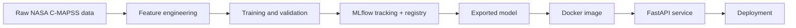

# Turbofan RUL MLOps Project

This project predicts the remaining useful life (RUL) of turbofan engines using the NASA C-MAPSS FD001 dataset. It demonstrates an end-to-end machine learning workflow with data preparation, feature engineering, experiment tracking in MLflow, a validated FastAPI service, Docker packaging, and a free-tier deployment path.

## Problem and why it matters

Predictive maintenance reduces unplanned downtime, maintenance cost, and safety risk. In aviation and industrial equipment, a small improvement in remaining-life prediction can prevent costly failures and support better maintenance scheduling.

## Architecture



## Current status

The public API and Docker deployment use the exported serving bundle in `models/`. The bundle is tracked in this repository so the hosted container has the model and metadata it needs at startup.

## Validation results

On one held-out engine-group fold from the local 3-fold GroupKFold split, the LightGBM model achieved an RMSE of **10.49 cycles**. For comparison, the naive baseline achieved **41.66 cycles** and Ridge regression achieved **16.56 cycles** on that same fold. This is a validation result, not a score on the official FD001 test set or an average across all three folds.

## Quickstart

```bash
python -m venv .venv
. .venv/bin/activate
pip install -r requirements.txt
make train
make mlflow-ui
make serve
```

Then call the API:

```bash
curl -X POST http://localhost:8000/predict -H "Content-Type: application/json" --data @examples/sample_request.json
```

## Design decisions

- RUL targets are clipped at 125 cycles because early-life degradation is not directly observable.
- Training and validation are split by engine to avoid leakage across units.
- All feature transformations are centralized in `src/turbofan/features.py` to keep training and serving consistent.
- LightGBM is served because it is strong on tabular sensor data and remains fast to load and predict in a small container.

## Limitations

- NASA C-MAPSS is simulated engine telemetry, not operational aircraft data.
- FD001 is a single-fault, single-condition dataset and does not represent all maintenance scenarios.
- The alert is currently triggered by a fixed 30-cycle RUL threshold; it is not cost-optimized.
- Weibull comparison models and prediction intervals are not implemented.
- Real-world sensor drift, monitoring, retraining, and stricter governance are outside this demo's scope.

## Live demo

**Public API documentation:** [elijah-chandler-portfolio.onrender.com/docs](https://elijah-chandler-portfolio.onrender.com/docs)

The live FastAPI docs let you inspect the endpoints and try requests interactively. Health check: [`/health`](https://elijah-chandler-portfolio.onrender.com/health).

The service runs on Render's free instance. After 15 minutes without traffic it may spin down; the first request afterward can take about a minute to wake it up. See [Render's free instance limitations](https://render.com/docs/free).

To run the service locally:

```bash
python -m uvicorn app.main:app --host 127.0.0.1 --port 8000
curl -X POST http://127.0.0.1:8000/predict -H "Content-Type: application/json" --data @examples/sample_request.json
```

## Notes

The false-alarm versus missed-failure tradeoff is important. A model that predicts failure too early can trigger expensive maintenance actions, while a model that predicts too late misses the maintenance window. The NASA score penalizes late predictions more heavily, which aligns with operational risk.
