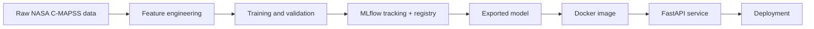

# Turbofan RUL MLOps Project

This project predicts the remaining useful life (RUL) of turbofan engines using the NASA C-MAPSS FD001 dataset. It demonstrates an end-to-end machine learning workflow with data preparation, feature engineering, experiment tracking in MLflow, a validated FastAPI service, Docker packaging, and a free-tier deployment path.

## Problem and why it matters

Predictive maintenance reduces unplanned downtime, maintenance cost, and safety risk. In aviation and industrial equipment, a small improvement in remaining-life prediction can prevent costly failures and support better maintenance scheduling.

## Architecture



## Current status

This repository is validated locally end-to-end for the training/export/serving workflow. The project successfully trains a model on the included synthetic fallback fixture, exports the champion bundle to the model directory, and serves predictions through the FastAPI app.

Real NASA FD001 data and a public cloud deployment are still external requirements; they are not present in this workspace, so the repository is confirmed as a working baseline implementation rather than a fully hosted production deployment.

## Quickstart

```bash
python -m venv .venv
. .venv/bin/activate
pip install -r requirements.txt
make train
make mlflow-ui
make serve
```

Then call the API:

```bash
curl -X POST http://localhost:8000/predict -H "Content-Type: application/json" --data @examples/sample_request.json
```

## Design decisions

- RUL targets are clipped at 125 cycles because early-life degradation is not directly observable.
- Training and validation are split by engine to avoid leakage across units.
- All feature transformations are centralized in `src/turbofan/features.py` to keep training and serving consistent.
- LightGBM is served because it is strong on tabular sensor data and remains fast to load and predict in a small container.

## Limitations

- The system uses simulated NASA data rather than real aircraft telemetry.
- FD001 is a single-fault, single-condition dataset and does not represent all maintenance scenarios.
- There is no real world sensor drift, so drift handling is still a production concern.
- Real deployment would require monitoring, retraining, and stricter governance.

## Live demo

Local demo endpoint:

```bash
python -m uvicorn app.main:app --host 127.0.0.1 --port 8000
curl -X POST http://127.0.0.1:8000/predict -H "Content-Type: application/json" --data @examples/sample_request.json
```

The project is validated locally at this endpoint, but it does not yet have a public deployment URL because no external hosting target was configured in the workspace.

## Notes

The false-alarm versus missed-failure tradeoff is important. A model that predicts failure too early can trigger expensive maintenance actions, while a model that predicts too late misses the maintenance window. The NASA score penalizes late predictions more heavily, which aligns with operational risk.
